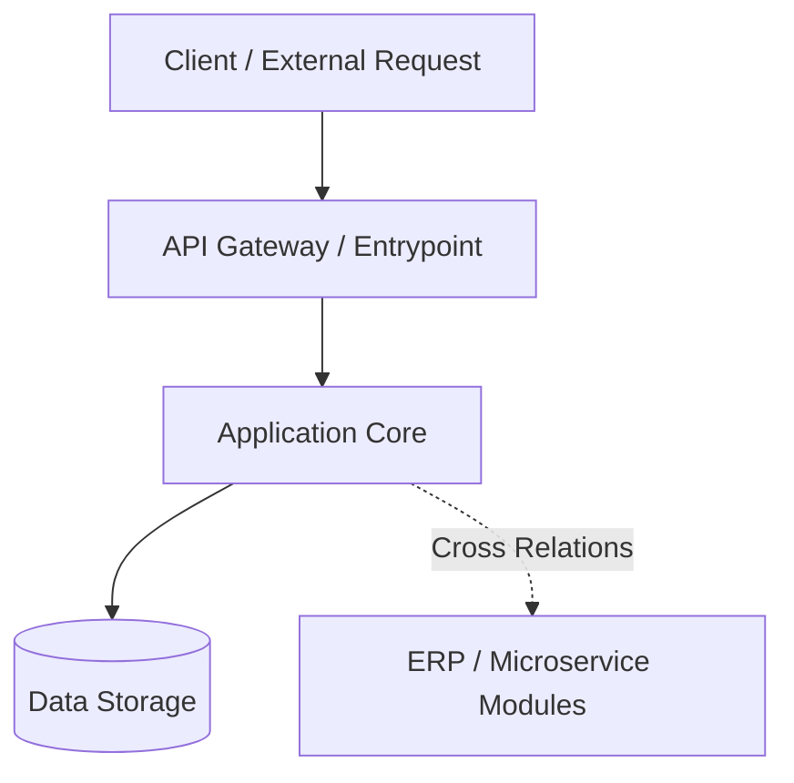

# Architecture Blueprint: WAIFU-ON-TELEGRAM

> Auto-generated by Waifu Project Architecture Engine.
> Source of truth for code structure, architectural patterns, and module dependencies.

## 1. Executive Summary
Aplikasi JavaScript/TypeScript, Python berbasis framework Custom / Scripting.

## 2. Technology Stack
• **Language(s)**: JavaScript/TypeScript, Python

## 3. Directory Layout
```text
C:\Users\sangp\waifu-on-telegram
├── bin/
├── data/
├── models/
├── open_design/
├── output/
├── personas/
├── scripts/
├── tests/
├── tools/
```

## 4. Architectural Diagram


## 5. Module & Cross-Project Dependencies
Project ini beroperasi dalam ekosistem multi-project. Setiap integrasi dengan servis lain (misalnya autentikasi, database terdistribusi, atau reporting) didokumentasikan di sini dan disinkronkan dengan memory vault `.waifu/project_memory.json`.

## 6. Coding & Quality Standards
1. **Clean Code & Modularity**: Setiap fungsi harus memiliki tanggung jawab tunggal (SRP).
2. **Documentation**: Perubahan endpoint atau schema harus memperbarui file ini.
3. **Zero-Regression**: Selalu verifikasi kompatibilitas dengan service yang bergantung pada project ini.
