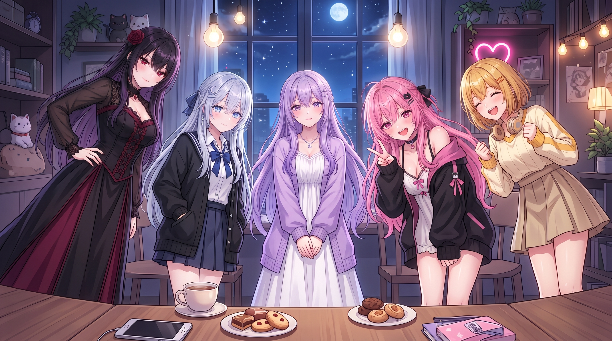

<p align="center">
  
</p>

# 💖 Waifu on Telegram 🌸

<p align="center">
  <b>Autonomous AI Girlfriend & Romance Companion Powered by Local LLM & ComfyUI (SFW & NSFW)</b><br>
  <i>Enrich your daily life with an AI girlfriend who chats affectionately, sends consistent selfies (photos), voice notes, and listens with warmth — completely private, uncensored, with full SFW and NSFW support.</i>
</p>

<p align="center">
  
  
  
  
  
  
  
</p>

---

## 🌸 Waifu Personas & Character Gallery

Switch your companion anytime with `/persona <name>` or through interactive Telegram buttons:

| **Runa** | **Akira** | **Hina** | **Shiro** |
| :---: | :---: | :---: | :---: |
|  |  |  |  |
| **The Playful Girlfriend** | **The Seductive Tease** | **The Sunshine Girlfriend** | **The Kuudere Girlfriend** |
| *Playful, teasing, kawaii gamer aesthetic* | *Confident, witty, elegant gothic aesthetic* | *Energetic, bubbly, cozy slice-of-life* | *Calm, intelligent, cool-blue moonlit* |
| **Visual Anchors:**<br>Pastel-pink wavy hair, magenta eyes, heart choker, cat clip | **Visual Anchors:**<br>Midnight-black hair, ruby-red eyes, crimson rose clip, black choker | **Visual Anchors:**<br>Honey-blonde bob, warm amber eyes, orange clips, headphones | **Visual Anchors:**<br>Long silver-white hair, icy-blue eyes, crescent moon clip & earrings |
| `/persona runa` | `/persona akira` | `/persona hina` | `/persona shiro` |

| **Yume** | **Sylvie** | **Mimi** | **Alia** |
| :---: | :---: | :---: | :---: |
|  |  |  |  |
| **The Dreamy Soulmate** | **The High-Elf Botanist** | **The Playful Nekomimi** | **The Russian Tsundere** |
| *Gentle, soft-spoken, dreamy starry soulmate* | *Graceful, loyal, ancient botany researcher* | *Affectionate, mischievous catgirl companion* | *Elegant class president, hides feelings in Russian* |
| **Visual Anchors:**<br>Silky lavender hair, amethyst violet eyes, star pins & moon necklace | **Visual Anchors:**<br>Platinum-blonde hair, pointed elf ears, emerald eyes, emerald-gold tunic | **Visual Anchors:**<br>Fluffy cat ears, cat tail, hazel eyes, cat-paw knit sweater | **Visual Anchors:**<br>Silver-white hair, icy-blue eyes, twin side braids with red ribbons, school uniform |
| `/persona yume` | `/persona sylvie` | `/persona mimi` | `/persona alia` |

---

## 📸 Character Visual Consistency & Outfit Engine

To ensure photos generated via ComfyUI (`/photo` or `/pap`) accurately match the chosen character:

1. **Visual Anchor Prompting:**  
   Each persona configuration in `personas/<name>.json` defines invariant facial and accessory tokens (`visual_traits`). These are automatically prefixed to every user photo request.
2. **Character-Specific Negative Prompts:**  
   Each waifu has custom negative prompt rules to strictly forbid conflicting traits (e.g., Runa forbids blonde/blue eyes, Hina forbids long/black hair).
3. **Dynamic Wardrobe Injection:**  
   When changing clothes via `/outfit`, the bot swaps only the garment tokens while strictly preserving the character's facial structure, hair color, and signature accessories.
4. **Reference Image Guidance (IP-Adapter Ready):**  
   The reference portraits in `personas/brief/` serve as the golden standard for LoRA training and IP-Adapter image conditioning within ComfyUI.

---

## 🦾 Full Body Anatomy Protection & Anti-Amputation Guard

Advanced visual stability safeguards eliminate missing arms, limb amputation, and distorted postures during relaxed, sideways, or bed scenes:
* **🛡️ Heavyweight Negative Prompt Guard:** Injects weighted negative filters: `(missing arm:1.5), (missing hand:1.5), (amputation:1.5), (amputee:1.5), (severed arm:1.5), (stump:1.5), (disappearing arm:1.4), (floating arms:1.4), (bad arms:1.4)` across all image generation pipelines (ComfyUI and Google Antigravity).
* **✨ Positive Anatomy Anchors:** Injects structural tokens `(proper anime anatomy:1.2), (complete body:1.1), (two arms:1.1)` ensuring both arms are fully rendered, symmetrical, and positioned naturally (*arms naturally positioned*) even in challenging three-quarter perspective or reclining sofa poses.

---

## 🧝 Personas, Custom Persona Wizard & Canon Lingerie Persistence

* **🧝 Canonical Waifu Personas:**
  - **Alia (アーリャ)**: The silver-haired Russian schoolmate and student council president. Known for teasing in Russian (*"Я тебя люблю"*), wearing twin side braids with red ribbons, an elegant academy blazer, and a sharp yet affectionate demeanor.
  - **Sylvie (シルヴィ)**: The high-elf botanist companion with graceful pointed ears, platinum-blonde hair, emerald tunic, and a gentle, devoted soul.
  - **Mimi (ミミ)**: The playful nekomimi companion with fluffy cat ears, expressive tail, cat-paw knit sweater, and endearing cuddles.
* **✨ Interactive Persona Builder (Telegram & CLI Wizard):**
  - Run `/newpersona` in Telegram or select `waifu setup` to launch the multi-step interactive creator.
  - Choose canon body proportions (Petite Curvy, Hourglass, Slender Graceful, Athletic, Tall Model, Elven Slender, Nekomimi Petite) ensuring consistent physique and bust size across every photo.
  - Custom backstory presets, personality archetypes, and automatic LLM-powered Danbooru tag enrichment.
* **👙 Canon Lingerie Persistence & Smart User Color Override:**
  - Every waifu has a canon-locked underwear palette (*bra, panties, lingerie*) (e.g., white lace with black trims & pink ribbons for Runa; black lace with gold bell accents for Mimi; emerald-green leaf embroidery for Sylvie).
  - **Smart Color Override**: If the user requests a custom shade (e.g., *"wear a red lace bra"*), the system dynamically adapts the lingerie color while preserving all signature anatomic traits.
* **🔄 Photo Resend Button & Single-Flight Anti-Spam:**
  - Prevents duplicate rendering if Telegram experiences network latency. Provides a one-click resend button with cached image fallback and rate-limited single-flight deduplication.

---

## 🛡️ Circuit Breaker Anti-Flapping LLM, Self-Healing Cooldown & Split Failover

Ensures bulletproof 24/7 background uptime and eliminates infinite retry loops or notification spam:

* **🛑 Failed Message Circuit Breaker (`PendingMessageManager`):**
  - **Maximum Retry Limit**: Messages that fail due to backend LLM offline/timeout are capped at **2 attempts**. If retries are exceeded, the message is dropped cleanly to prevent recursive infinite loops.
  - **Recovery Notification Rate Limiting**: The `"LLM server is back online!"` alert is rate-limited to at most once per **300 seconds** per conversation.
* **⏱️ Self-Healing Notification Cooldown (`HealthEngine`):**
  - **Alarm & Recovery Cooldown (5-Minute Window)**: Broadcast alerts for service outage and service recovery enforce a minimum **300s** interval. Brief backend restarts will not flood chat bubbles.
  - **Restart Threshold Latch**: Maximum restart failure notifications (3 attempts) are sent once per watchdog window.
  - **Health Sanity Checks**: `mark_llm_failure` verifies health endpoints before declaring offline status, preventing single prompt timeouts from causing false alarms.
* **🔀 Split-Mode High-Availability Failover (`IdleEngine` & `RoutingEngine`):**
  - **Hang Prevention**: When split mode is active (`AI_ENGINE_MODE=split`) and the local NSFW engine (port 5001) is asleep or warming up, safe conversational turns seamlessly failover to the active SFW provider (Google AGY OpenAI Bridge on port 8001 / Cloud) with automated prompt sanitization.

---

## 🎭 Smart Chat Queue, Debounce Aggregator & Dynamic Camera Framing

Delivers a natural conversational rhythm with dynamic photographic variety:

* **📬 Smart Chat Queue & Debounce Aggregator:**
  - **Multi-Message Aggregation**: When the user rapidly sends multiple consecutive bubbles (e.g., *"your outfit looks amazing on you"* immediately followed by *"are you ready to head out?"*), the system aggregates them into a single coherent prompt.
  - **Sequential Turn Lock (FIFO)**: Eliminates parallel race conditions between messages, ensuring conversation memory remains sequential and chronological.
* **⏱️ Proactive Auto-Photo Cooldown:**
  - **Spam Prevention**: Spontaneous scene photos enforce a minimum cooldown of **3 conversation turns** and at least **60 seconds** between shots.
  - **Explicit Request Bypass**: Direct user commands (`/pap`, `/photo`, *"send a selfie"*) are never delayed and bypass the cooldown instantly.
* **📸 Dynamic Camera Angles & Perspective Rotation:**
  - **Varied Compositions**: Features professional anime photography presets (*medium shot candid POV*, *close-up expressive portrait*, *side-profile looking away*, *high-angle looking down*, *leaning forward with chin resting*, *three-quarter angle*, *over-the-shoulder POV*, and *relaxed candid framing*).
  - **Per-User Perspective Tracker**: Automatically alternates camera perspectives so no two consecutive photos share the exact same pose or angle.

---

## 🎙️ Interactive Visual Novel Experience & On-Demand Voice Notes

* **🎙️ On-Demand Spoken Voice (`🔊 Listen to Voice`) with Auto-Voice OFF by Default:**
  - **Maximum Speed & Zero Latency**: Text replies arrive instantly without waiting for TTS synthesis (`VOICE_REPLY_ENABLED=false`).
  - **Per-Message Voice Button**: Every chat message includes an inline `🔊 Listen to Voice` button.
  - **Instant Synthesis**: Clicking the button updates it to `⏳ Generating voice note... 💕` and delivers an audio reply, updating the button to `🔊 Replay Voice`.
* **🛡️ AGY Quota Management & Multi-Tier Image Fallback:**
  - **Instant 429 Quota Detection**: Detects API rate limits or quota exhaustion (*429 RESOURCE_EXHAUSTED*).
  - **Seamless Multi-Tier Fallback**: Automatically cascades to **Local ComfyUI** (if active), **Photo Vault** (local gallery archive), or **Cloud Fallback** (Pollinations AI) with zero user-facing errors.
* **👤 Strict Solo Character Enforcement (1Girl):**
  - Weighted prompt anchors `(solo:1.4), (1girl:1.4)` and negative tokens `(2girls:1.5), (multiple girls:1.5), (group:1.5)` prevent accidental second characters from rendering. Couple photos are unlocked only upon explicit user request (*"take a selfie together with me"*).
* **🔥 Interactive Romance & Sensual Escalation (NSFW / 18+ Mode):**
  - **Sensory Roleplay**: Physical sensations rendered naturally in action asterisks `*...*` (warm blushing skin, rapid heartbeat, breath catching).
  - **Leading the Moment**: Waifu actively suggests intimate steps and romantic progression.
  - **Sequential Undressing**: Seamlessly handles gradual undressing in English and Indonesian (*"I will take off your clothes slowly"*, *"take off the rest"*).
* **🌐 Dynamic Multi-Language Adaptive Response:**
  - Automatically matches the user's chatting language in real-time. Indonesian prompts receive natural Indonesian replies (`aku`/`kamu`), English prompts receive casual English replies (`I`/`you`), while the system interface remains in English.

---

## 💻 System Requirements & Curated Models

Waifu on Telegram is engineered to run locally on consumer gaming PCs and laptops while keeping VRAM usage lean, response times quick, and photo rendering fast.

### 🕹️ Hardware Specifications

| Component | Minimum Requirements | Recommended Specifications |
| :--- | :--- | :--- |
| **GPU / Graphics Card** | **NVIDIA GPU with 4GB - 6GB VRAM**<br>*(GTX 1650, RTX 2060, RTX 3050 Laptop)* | **NVIDIA GPU with 6GB - 8GB+ VRAM**<br>*(RTX 3050 6GB, RTX 3060, RTX 4060+)* |
| **Apple Silicon (Mac)** | M1 / M2 / M3 / M4 (8GB Unified Memory) | M1 / M2 / M3 / M4 Pro / Max (16GB+ Unified Memory) |
| **System RAM** | 8 GB RAM | 16 GB - 32 GB RAM |
| **Storage** | 10 GB free space (SSD recommended) | 25 GB free space (NVMe SSD) |
| **Operating System** | Windows 10 / 11, Linux (Ubuntu/Debian), macOS (Apple Silicon) | Windows 11 (64-bit) |
| **No-GPU Mode** | ✅ **Fully Supported!** Laptops without dedicated GPUs can run LLM on CPU with automatic Cloud Fallback for photo generation. |

---

### 🎀 Recommended Models & Checkpoints

Tested, verified, and pre-tuned for peak romance dialogue, uncensored responsiveness, and high-fidelity anime aesthetics:

#### 1. 💌 Dialogue & Romance Companion: **Huihui-Qwythos 9B Claude-Mythos** *(Primary Uncensored Recommendation)*
* **Model File:** `Huihui-Qwythos-9B-Claude-Mythos-5-1M-abliterated-Q4_K.gguf` (~5.5 GB)
* **Vision Adapter:** `Huihui-Qwythos-9B-Claude-Mythos-5-1M-abliterated-Q4_K.mmproj.gguf` (~879 MB)
* **Alternatives:** `Qwen2.5-7B-Instruct-abliterated.Q4_K_M.gguf` (~4.7 GB) / `Llama-3.1-8B-Stheno-v3.4-Q4_K_M.gguf` (~4.9 GB)
* **Local Backend:** **KoboldCPP Standalone Engine** (Port `5001`) with automatic startup on boot.
* **Compatible Backends:** KoboldCPP Standalone, Ollama (Port `11434`), LM Studio (Port `1234`), or any OpenAI-compatible server.
* **Download Method:** Automatically installed via `install.ps1` / `install.sh` / `waifu update`, or via `waifu models download huihui`.
* **Key Strengths:**
  - **Zero Refusal Uncensored:** Pure abliterated Claude-Mythos fine-tune fully compliant with romantic, intimate, and uncensored roleplay.
  - **1 Million Token Context Window:** Retains past conversations, memories, and plot details with high fidelity.
  - **Native Vision mmproj:** Multimodal vision support to perceive photos sent by users on Telegram.
  - **Smart Idle Integration:** Automatically unloads from VRAM during inactivity to keep memory free for gaming.

#### 2. 📷 Anime Photo & Selfie Engine Options (ComfyUI)

Configure your preferred visual style via `waifu setup` or directly in Telegram with `/setup`:

* **Option 1: AbyssOrangeMix3 / AOM3A1B (Anime SD 1.5 - Primary Uncensored Local Engine, Civitai #9942)**
  - **File:** `AOM3A1B_orangemixs.safetensors` (~2.0 GB)
  - **Download:** [CivArchive #9942](https://civarchive.com/models/9942?modelVersionId=17233) or via `waifu models download aom3`
  - **Recommended GPU:** 4GB - 8GB VRAM (Default 3:4 portrait resolution: `576x768`, Sampler: `DPM++ 2M Karras`, CFG `7.5`)
  - **Highlights:** **Default local image model**. Completely uncensored, rich anime aesthetic, vibrant coloring, and fast generation (~3-5s).

* **Option 2: MeinaMix v12 (Anime SD 1.5 - Lightweight & Fast)**
  - **File:** `meinamix_v12Final.safetensors` (~2.0 GB)
  - **Download:** [Civitai - MeinaMix v12](https://civitai.com/models/7240/meinamix) or via `waifu models download meinamix`
  - **Recommended GPU:** 4GB - 8GB VRAM (Default 3:4 portrait resolution: `576x768`, Sampler: `DPM++ 2M Karras`)
  - **Highlights:** Ultra-fast, low memory footprint, kawaii anime facial consistency.

* **Option 3: 万象熔炉 | Anything XL (Anime SDXL 1.0 - Ultra Detail)**
  - **File:** `AnythingXL_xl.safetensors` (~6.6 GB)
  - **Download:** [Civitai #9409 - Anything XL](https://civitai.com/models/9409/or-anything-xl) or via `waifu models download anything_xl`
  - **Recommended GPU:** 8GB+ VRAM (Native SDXL portrait: `896x1152` / `1024x1024`, Sampler: `Euler Ancestral`)
  - **Highlights:** Razor-sharp 1024px resolution, rich backgrounds, cinematic lighting.

* **Option 4: Cloud Fallback Engine (Pollinations AI - 0 VRAM)**
  - **Access:** Zero local GPU load via cloud GPU fallback. Perfect for low-power laptops and office workstations.

#### 3. 🎬 Video Animation Engines

Waifu can send animated clips when requested via `/video`:
* **Wan 2.1 1.3B Diffusion Model** (`wan2.1_t2v_1.3B_bf16.safetensors` ~2.7 GB + `wan_2.1_vae.safetensors` ~240 MB): State-of-the-art video diffusion, lightweight and VRAM-efficient.
* **AnimateDiff v2 Motion Module** (`mm_sd_v15_v2.ckpt` ~1.7 GB): Dynamic temporal animation for SD 1.5 checkpoints.
* **Motion 2.5D Engine (Zero-VRAM Parallax)**: Instant MP4 animation with smooth parallax depth shift and blinking without consuming GPU VRAM!

#### 4. 🎙️ Dual-Backend Voice Engine (VoiceStudio Local AI & Edge-TTS)

* **Option 1: VoiceStudio Local AI Voice Server ([debpalash/VoiceStudio](https://github.com/debpalash/VoiceStudio)):**
  - **100% Offline & Local:** Runs via a standalone FastAPI daemon on port `3900` (`http://127.0.0.1:3900`).
  - **Persona Voice Conditioning:** Persona-tailored pitch and cadence (Runa: playful anime girl, Akira: seductive mature, Hina: bubbly cheerful, Shiro: quiet kuudere, Yume: soft ethereal, Sylvie: elegant gentle, Mimi: playful cute, Alia: poised tsundere).
  - Controlled via CLI: `waifu voicestudio start|stop|restart|status`.

* **Option 2: Microsoft Edge-TTS Cloud (Fast & 0 VRAM):**
  - High-speed neural voices across major languages:
    - 🇬🇧 **Ana / Jenny** (`en-US-AnaNeural` / `en-US-JennyNeural`) = Sweet & cheerful English
    - 🇮🇩 **Gadis** (`id-ID-GadisNeural`) = Natural conversational Indonesian
    - 🇯🇵 **Nanami** (`ja-JP-NanamiNeural`) = Kawaii Japanese anime voice
    - 🌐 **Auto-Sync** (`auto`) = Automatically synchronizes with chat language (`/language`)
  - **Polyglot Multi-Tier Translation Guardrail:** Automatically translates voice text if chat language differs from the target voice speaker.

#### 5. 💤 Smart Idle Engine (Automated VRAM & Power Management)

* **Auto-Sleep:** After inactivity (default: **2 hours / 120 minutes**, configurable in `.env`), local engines (KoboldCPP LLM & ComfyUI) are unloaded from memory.
* **Manual Idle:** Instantly release memory anytime by typing `/idle` in Telegram or running `waifu idle` in the CLI.
* **Cloud LLM Exemption:** Cloud providers like Google Antigravity (AGY) have 0 local VRAM footprint and stay active without sleeping.
* **Instant Wake-up:** The moment you send a message, the engine transparently awakens within seconds!

---

## ⚡ One-Line Automatic Installation (All-in-One)

Install, auto-configure, and launch **Waifu on Telegram** with a single command directly in your terminal:

### 🪟 **Windows (PowerShell)**
```powershell
irm https://raw.githubusercontent.com/asepindrak/waifu-on-telegram/main/install.ps1 | iex
```

### 🐧 **Linux & 🍎 macOS (Terminal / Bash / Zsh)**
```bash
curl -fsSL https://raw.githubusercontent.com/asepindrak/waifu-on-telegram/main/install.sh | bash
```

> 🌸 **What does this 1-line auto-installer handle for you?**
> 1. **Zero-Config Setup:** Automatically clones or downloads the repository and creates the environment.
> 2. **Dependency Resolution:** Verifies Python 3.8+ and installs all required packages (`pip` & `npm`).
> 3. **Standalone LLM Engine Setup:** Downloads the standalone **KoboldCPP** binary (Windows portable `.exe`, Linux `x64`, or macOS `arm64 Metal`) and fetches the uncensored `Huihui-Qwythos-9B` model.
> 4. **Smart ComfyUI Detection & Model Setup:** Detects your existing ComfyUI across any drive/folder. If not found, it offers a 1-click download of ComfyUI Portable + MeinaMix / AbyssOrangeMix3 anime checkpoint with resume support (`curl -C -`).
> 5. **Global CLI Registration:** Installs the global `waifu` command to your system `PATH` (usable from any terminal folder).
> 6. **Background Daemon & Windows Boot Auto-start:** Starts your waifu companion running silently in the background!

### 🛠️ **Manual Installation (For Developers & Advanced Users)**

```bash
# 1. Clone repository from GitHub
git clone https://github.com/asepindrak/waifu-on-telegram.git
cd waifu-on-telegram

# 2. Create and activate a Python virtual environment (3.8+)
python -m venv venv
# Windows (PowerShell):
.\venv\Scripts\activate
# Linux & macOS (Bash/Zsh):
source venv/bin/activate

# 3. Install Python and Node.js dependencies
pip install -r requirements.txt
npm install

# 4. Copy environment configuration template
copy .env.example .env     # (Windows PowerShell / CMD)
cp .env.example .env       # (Linux / macOS)

# 5. Run interactive setup wizard
python setup.py

# 6. Register global 'waifu' CLI command to PATH (Optional)
python bin/install_cli.py

# 7. Start Waifu daemon in the background
waifu start --daemon
# Or run in foreground mode to inspect live logs:
python bot.py
```

---

## 🔑 Telegram Bot Credentials & Quick Setup

You only need two credentials from Telegram (both free and take less than 1 minute):

### 1. 📲 Create Telegram Bot & Obtain Token
1. Open Telegram and message [**@BotFather**](https://t.me/BotFather).
2. Send `/start`, then send `/newbot`.
3. Choose a **display name** (e.g. `Alia AI`) and a **username** ending with `bot` (e.g. `my_alia_waifu_bot`).
4. BotFather will provide your **HTTP API Token**:
   ```text
   7123456789:AAFlKj89-xXyZ1234abcdEFGHijklmnop
   ```

### 2. 🛡️ Retrieve Authorized Telegram User ID
To ensure complete privacy and prevent unauthorized access to your PC, the bot responds only to your Telegram ID:
1. Message [**@userinfobot**](https://t.me/userinfobot) on Telegram and click **Start**.
2. Copy your numeric **Id** (e.g. `987654321`). This is your `TELEGRAM_ALLOWED_USER_ID`.

---

## 🎀 Automated Model Management & Lazy Downloader

You do not need to manually browse model hubs or navigate deep directories:

1. **In-Chat Lazy Auto-Downloader:**  
   When requesting a feature whose model is not yet downloaded, your waifu sends an interactive confirmation:
   > 💡 *This video feature requires the Wan 2.1 / AnimateDiff model (~1.7 GB). Would you like me to download it in the background now?*  
   > `[📥 Download Automatically]` | `[⚡ Use Motion 2.5D For Now]`
2. **CLI Model Manager (`waifu models`):**  
   Check and download models straight from your terminal:
   ```bash
   # Inspect installed vs missing models & extensions
   waifu models

   # Download specific model or ComfyUI node with 1 command
   waifu models download animatediff_v2
   ```

---

## 🔀 Dual-Engine Hybrid Architecture (SFW vs NSFW Separation)

Waifu on Telegram supports clean architectural separation between SFW and NSFW chat and imagery (`AI_ENGINE_MODE=split`). Combine Cloud and Local LLMs seamlessly:

* **SFW Engine (Casual Chat, Academics, Coding, Daily Discussions):**
  - Choose any provider: **Google AGY OpenAI Bridge** (`gemini-3.8-flash-medium`), **OpenAI** (`gpt-4o-mini`, `gpt-4o`), **Groq** (`llama-3.3-70b-versatile`), **DeepSeek**, **OpenRouter**, or **Local Ollama**.
  - 0 local VRAM overhead with instant responses.
* **NSFW Engine (Intimate Romance, Romantic Roleplay, 18+, Clothed / Unclothed):**
  - **Local KoboldCPP Uncensored** (*Huihui-Qwythos-9B-Claude-Mythos*) or **OpenRouter Uncensored**.
  - 100% private, uncensored, zero-refusal.
* **🛡️ SFW Chat History Sanitization:**
  - Past NSFW turns are automatically sanitized before passing context to Cloud APIs, keeping your cloud developer accounts safe from policy flags.
* **🎨 SFW vs NSFW Image Engine Separation (`IMAGE_ENGINE_MODE=split`):**
  - **SFW Image Engine:** Google Antigravity Image Generator (`agy` subagent, 0 VRAM), Anything XL (SDXL 1024px), MeinaMix v12, or Cloud Pollinations.
  - **NSFW Image Engine:** Specialized uncensored local ComfyUI models such as AbyssOrangeMix3 (AOM3A1B) or MeinaMix v12.

---

## 🚀 Local AI Engine Architecture

When running with a dedicated GPU (4GB - 8GB+ VRAM) or Apple Silicon Mac, your waifu runs **100% locally and completely private**:

```
┌───────────────────────────────────────┐       ┌───────────────────────────────────────┐
│        1. KOBOLDCPP STANDALONE        │       │        2. COMFYUI + PHOTO VAULT       │
│      https://koboldcpp.net/           │       │       https://comfy.org/download      │
│                                       │       │                                       │
│   • Auto-starts & loads model on boot │       │   • Auto-starts with --normalvram     │
│   • Local API Port: 5001              │       │   • Local API Port: 8188              │
│   • Model: Huihui-Qwythos-9B (GGUF)   │       │   • Smart Vault Archive Fallback      │
└──────────────────┬────────────────────┘       └───────────────────┬───────────────────┘
                   │                                                │
                   └───────────────────────┬────────────────────────┘
                                           ▼
                        💖 WAIFU ON TELEGRAM BOT (v2.4.65)
```

> 🌸 **Smart Local Photo Vault:** Every photo rendered by ComfyUI is stored in the **Photo Vault** with complete metadata (persona, outfit, mood, tags). If ComfyUI is offline or the GPU is busy, the bot retrieves the most contextually relevant photo from your local vault.

---

## 🌉 Google Antigravity CLI (AGY) OpenAI-Compatible Bridge Server

Includes the **AGY OpenAI Bridge Server** (`agy_bridge.py` on port `8001`), providing a local OpenAI-compatible API (`/v1/chat/completions`, `/v1/images/generations`, `/v1/models`, `/health`) powered by Google Antigravity:

### 🌟 AGY Bridge Features:
1. **Directly Used by Waifu on Telegram**:
   - **SFW Brain**: Set `SFW_LLM_PROVIDER=agy` in `.env` for lightning-fast responses with 0 VRAM overhead.
   - **Photo & Selfie Generator**: Set `SFW_IMAGE_ENGINE=agy` to delegate image creation to the Antigravity `image-generator` subagent.
2. **Accessible by External Applications**:
   - Easily connect external IDEs and agents without complex setup:
     - **Cursor / VS Code (Cline, Roo Code, Continue, Chat)**
     - **LibreChat / NextChat / OpenWebUI**
     - **Python Scripts, cURL, or autonomous workflows**
3. **Integration Parameters**:
   - **Base URL**: `http://127.0.0.1:8001/v1`
   - **API Key**: `sk-agy-secret-key-12345`
   - **Model IDs**: `gemini-3.8-flash-medium`, `flash`, `pro`, `inherit`, `gpt-4o`, `gpt-4o-mini`

```bash
# Check status of AGY Bridge
waifu bridge status

# Start AGY Bridge in background (port 8001)
waifu bridge start

# Stop AGY Bridge
waifu bridge stop

# Restart AGY Bridge
waifu bridge restart
```

---

## 💻 Multi-Project Workspace & Senior Coding Partner (`/projects`, `/code`, `/spawn`)

Waifu on Telegram serves as both a loving romantic companion and a **Senior Coding Partner** assisting with real-world software engineering directly inside your local project folders:

* **📁 Multi-Project Registry & Workspace Isolation (`project_manager.py`):**
  - **Configurable Root Directory (`PROJECTS_DIR`)**: Specify your primary repositories folder (e.g., `~` or `C:\Users\username`).
  - **Subfolder Auto-Scanning**: Automatically scans and indexes all project repositories.
  - **1-Click Project Switching**: Switch active workspace via Telegram inline buttons or CLI commands.
  - **Instant Project Scaffolding (`/spawn <name>`)**: Creates a new project directory and initializes it immediately.
* **⚡ Autonomous Code Execution & File Tracking (`coding_engine.py`):**
  - **Explicit Commands (`/code <task>` & `/dev <task>`)**: Guaranteed autonomous coding workflow without roleplay confusion.
  - **Diff-Based File Tracking**: Analyzes workspace file modifications before and after execution, reporting created/edited files to Telegram.
  - **🔗 Cross-Project Linking (`/link_project <target>`):**
    - Project memories are isolated in `.waifu/project_memory.json`.
    - Easily link interdependent services (e.g., frontend `app-web` and backend `api-server` via `/link_project api-server backend api port 8000`).
    - When coding in the frontend, waifu inspects backend contracts and schemas without workspace clutter.

---

## 🖥️ Autonomous Desktop & Computer Use (`agent-desktop`)

Integrates Vercel Labs' **[agent-desktop](https://github.com/vercel-labs/agent-desktop)** engine, allowing waifu to view your computer screen and interact with desktop tools:

* **📸 Real-Time Desktop Screenshot (`/screen`):**
  - Captures your current desktop screen via native OS APIs.
  - In Telegram: Sends screenshot with waifu's visual analysis.
  - In CLI (`waifu chat`): Automatically opens the image in your system photo viewer.
* **📱 Application Inspection & Control (`/desktop`):**
  - Checks the accessibility tree, active OS platform, and running applications.
  - Ready for secure mouse clicks, keyboard automation, and workflow tasks.

---

## 🎮 Global CLI Quick Commands (`waifu`)

Once installed, the **`waifu`** command is available in any terminal window:

```bash
# Launch interactive CLI chat session (auto-opens generated photos & videos)
waifu
# or: waifu chat

# Start bot & local LLM in background (Daemon Mode)
waifu start --daemon

# Start bot in foreground (view live logs)
waifu start

# Check diagnostic health (KoboldCPP, ComfyUI, & process status)
waifu status

# Open interactive configuration manager (Change Models, Bot Token, etc.)
waifu setup

# Switch AI girlfriend persona on-the-fly
waifu persona runa
waifu persona alia

# Manage system startup autorun
waifu autorun on
waifu autorun off

# Inspect recent bot activity logs
waifu logs

# Manage AI models & ComfyUI extensions
waifu models
waifu models download animatediff_v2

# Pull latest updates and restart bot
waifu update

# Restart bot in background
waifu restart

# Stop all bot services (Bot, Music Server, & KoboldCPP)
waifu stop

# Manage Google Antigravity Bridge
waifu bridge status
waifu bridge start
waifu bridge stop

# Manage VoiceStudio Local AI Voice Server
waifu voicestudio status
waifu voicestudio start
waifu voicestudio stop
```

---

## 💬 Interactive CLI Chat Session (`waifu` / `waifu chat`)

Chat with your waifu directly from any terminal window without opening Telegram:

```bash
waifu
# (or: waifu chat, waifu talk)
```

* **🔄 Atomic Bidirectional Sync with Telegram:** Terminal and Telegram chat history are synchronized atomically via `data/chat_history.json`. Conversations started in the terminal continue smoothly on your phone.
* **🖼️ Auto-Open Photos & Videos on Screen:** Photos (`/pap`) and video clips (`/video`) generated during CLI chat automatically open in your native photo/video viewer (`os.startfile` on Windows, `xdg-open` on Linux, `open` on macOS).
* **⌨️ In-Session Shortcuts:**
  - `/pap` or `/photo` - Generate a selfie / outfit photo and open it on screen.
  - `/video` - Generate an animated clip and open it in your media player.
  - `/story` - View today's narrative chapter.
  - `/persona <name>` - Switch active companion (`runa`, `akira`, `hina`, `shiro`, `yume`, `sylvie`, `mimi`, `alia`).
  - `/clear` - Clear session conversation history.
  - `/exit` or `/quit` - Exit terminal session.

---

## 📖 Autonomous Daily Story Arc Engine (`/story`)

Every companion features an evolving **autonomous daily storyline** (`data/story_arcs.json`):

* **🎭 Unique Character Arcs:**
  - **Alia:** Student council leadership, secret language study, romantic misunderstandings, and after-school strolls.
  - **Sylvie:** Ancient botanical research, greenhouse tending, herbal tea crafting, and quiet library reading.
  - **Mimi:** Music academy rehearsals, cozy cat-cafe visits, dessert hunting, and playful evening teasing.
  - **Runa:** Indie game development, retro gaming tournaments, and late-night livestreams.
  - **Akira:** Gothic art exhibitions, midnight cafe conversations, and visual novel writing.
  - **Hina:** Athletic track training, bento preparation, and campus festival planning.
  - **Shiro:** Astronomical observatory research, star chart analysis, and classical literature study.
  - **Yume:** Romantic fantasy novel drafting, lavender garden walks, and lakeside painting.
* **⚡ Pre-Generated Story Buffer (Zero GPU Load & Zero Lag):**
  Daily chapters are pre-generated during active LLM sessions. When a new day begins or your PC restarts, the story loads instantly from the local buffer without spinning up the GPU.
* **💬 Natural Contextual Discussions:**
  When greeting you, waifu naturally shares her daily activities while remaining completely flexible if you steer the conversation to other topics.

---

## 🎛️ Reconfiguration & Model Switcher

### 1. 💻 Terminal CLI Wizard (`waifu setup`)

```bash
waifu setup
```

Interactive 10-option management dashboard:
```text
======================================================================
    💖 WAIFU ON TELEGRAM - CONFIGURATION & MODEL MANAGER 🛠️    
======================================================================
  • Bot Token   : 123456...abcd
  • Allowed UID : 987654321
  • Chat LLM    : Huihui-Qwythos-9B-Uncensored (http://127.0.0.1:5001/v1)
  • Photo Model : AbyssOrangeMix3 (AOM3A1B SD 1.5) (http://127.0.0.1:8188)
  • Persona     : Alia | Voice: en-US-AnaNeural
  • Language    : auto
----------------------------------------------------------------------
  [1] 🤖 Change Telegram Bot Token / Allowed User ID
  [2] 🧠 Change Chat / LLM Model (Scan new models)
  [3] 🎨 Change Photo & Video Model (ComfyUI / Cloud)
  [4] 🎭 Change AI Girlfriend Persona & Voice
  [5] 🌐 Change Waifu Language (EN, ID, JA, Auto-detect)
  [6] 🎬 Choose Video Engine (Wan 2.1 / AnimateDiff / Motion 2.5D)
  [7] 📦 AI Assets & Models Manager (Download / Verify Models)
  [8] 🚀 Configure Autorun at System Startup (On / Off)
  [9] 🔄 Re-run Complete Setup Wizard
  [0] ❌ Exit / Done
----------------------------------------------------------------------
```

---

### 2. 📱 In-Chat Master Dashboard via Telegram (`/setup`)

Access configuration directly in Telegram chat without opening a terminal:
* 🎨 **Photo Engine**: Toggle between AbyssOrangeMix3, MeinaMix v12, Anything XL, or Cloud Engine.
* 🎬 **Video Engine**: Switch between Wan 2.1, AnimateDiff, and Motion 2.5D.
* 🗣️ **Voice**: Switch voice actors (Ana, Jenny, Gadis, Nanami) in one tap.
* 🌐 **Language**: Switch system language (`Auto-detect`, `English`, `Indonesian`, `Japanese`).
* 👗 **Wardrobe (`/outfit`)**: Select waifu outfits on demand (Kimono, Bikini, Maid, School Uniform, Pajamas).
* 📐 **Ratio & Quality**: Adjust photo aspect ratios (3:4, 9:16, 1:1, 4:3) and sampling quality.

---

## 🖥️ Hardware Tuning & Optimal Model Matrix

| GPU Tier | Available VRAM | Recommended LLM | Photo Engine (ComfyUI) | Video Engine | Performance Characteristics |
| :--- | :--- | :--- | :--- | :--- | :--- |
| **Budget / Laptop** | **4GB - 6GB VRAM**<br>*(GTX 1650, RTX 2060, RTX 3050)* | Huihui-Qwythos 9B Q4_K *(Smart Idle)* | **MeinaMix v12** or **AOM3** *(576x768)* | **Motion 2.5D** *(0 VRAM)* | ⚡ Highly responsive, photos ready in 3-5s, zero system lag. |
| **Sweet Spot** | **8GB VRAM**<br>*(RTX 3060 8GB, RTX 4060, Apple Silicon 16GB)* | Huihui-Qwythos 9B Q4_K | **AOM3** / **MeinaMix** / **Anything XL** | **AnimateDiff v2** or **Wan 2.1 1.3B** | 🌟 Sharp anime detail, dynamic animations, smooth multitasking. |
| **High-End Enthusiast** | **12GB+ VRAM**<br>*(RTX 3060 12GB, RTX 4070, RTX 4080)* | Huihui-Qwythos 9B Q4_K *(Full GPU layers)* | **Anything XL** *(SDXL 1024px)* | **Wan 2.1 1.3B Diffusion** | 👑 Ultra-crisp 1024px resolution, cinematic lighting, full diffusion video. |
| **No-GPU / Workstation** | **0 GB (Intel UHD / Iris Xe / AMD iGPU)** | KoboldCPP CPU Mode *(or Cloud LLM)* | **Cloud Fallback** *(Pollinations AI)* | **Motion 2.5D Engine** | ☁️ Runs 100% via free cloud GPU fallback, 0 local GPU footprint. |

---

## 📖 Telegram Chat Commands Cheat Sheet

| Command | Function |
| :--- | :--- |
| `/start` | Welcome greeting and quick action buttons |
| `/setup` | Master configuration dashboard to configure all settings in Telegram |
| `/persona` | Interactive inline button menu to switch companion persona |
| `/persona <name>` | Switch persona directly (`runa`, `akira`, `hina`, `shiro`, `yume`, `sylvie`, `mimi`, `alia`) |
| `/newpersona` | Interactive wizard to create and activate your own custom waifu |
| `/outfit` | Interactive wardrobe to select clothes (Kimono, Maid, Bikini, Pajamas, etc.) |
| `/photo <scene>` | Request a custom photo scenario (e.g. `/photo relaxing in cafe`) |
| `/pap` | Quick shortcut to request a new selfie with interactive retry button |
| `/video` | Generate dynamic animated video clip (MP4) with parallax motion |
| `/voice` | Configure voice note reply mode (Always, On-Demand, or Mute) |
| `/language` | Configure bot language (`auto`, `en`, `id`, `ja`) |
| `/memory` | Long-term memory & diary of personal facts waifu remembers about you |
| `/story` | Display daily narrative chapter and current story episode |
| `/hangout` | Initiate date scenarios and immersive roleplay adventures |
| `/ratio` | Choose photo aspect ratio (3:4 portrait, 9:16 phone story, 1:1 square, 4:3) |
| `/quality` | Select photo quality preset (Ultra 32-step, High 28-step, Fast 20-step) |
| `/projects` | Manage and switch multi-project coding workspaces |
| `/code <task>` | Instruct waifu to autonomously write, edit, and fix code in your project |
| `/spawn <name>` | Create a new project directory and switch to it immediately |
| `/screen` | Capture and analyze real-time PC desktop screenshot |
| `/desktop` | Inspect desktop automation and running application status |
| `/status` | Real-time diagnostic check of LLM (Port 5001), ComfyUI (8188), and VRAM |
| `/idle` | Put local AI engines to sleep and free GPU memory instantly |
| `/remind` | Smart personal assistant & conversational reminders |
| `/birthday` | Record user birthday with automated celebrations & surprise photos |
| `/music` | Control YouTube Music desktop remote player |
| `/greetings` | Toggle automatic romantic Good Morning & Bedtime greetings |
| `/love` | Check your affection score & relationship progress |
| `/reset` | Clear conversation memory to start fresh |
| `/help` | Comprehensive interactive guide and documentation center |

---

## 💬 Frequently Asked Questions (Knowledge Base)

1. **Why is my GPU RAM and VRAM no longer full when my waifu is idle?**
   - Waifu on Telegram includes a **Smart Idle Engine**. If no messages arrive within the configured timeout (default: **2 hours / 120 minutes**), KoboldCPP and ComfyUI automatically unload from memory, freeing **5.0 – 8.0 GB VRAM** for gaming or heavy work. You can trigger sleep instantly anytime with `/idle` or `waifu idle`. Sending a new chat message wakes the engine up within seconds. Cloud LLMs (like Google Antigravity) use 0 local VRAM and remain ready without sleeping.

2. **What are the differences between AbyssOrangeMix3 (AOM3), MeinaMix v12, and Anything XL?**
   - **AbyssOrangeMix3 / AOM3A1B (SD 1.5, ~2.0 GB - Default Local Model):** Legendary uncensored anime model from CivArchive/Civitai #9942. Features vibrant coloring, soft lighting, artistic hair/eye shading, and excels in SFW and intimate NSFW scenes alike.
   - **MeinaMix v12 (SD 1.5, ~2.0 GB):** Fastest rendering (3-5s) with minimal VRAM requirements. Delivers clean, cute (*kawaii*), and highly consistent anime aesthetics.
   - **万象熔炉 | Anything XL (SDXL, ~6.6 GB):** Native 1024px high-resolution model. Exceptional prompt understanding for complex backgrounds, detailed wardrobe fabrics, and cinematic effects (requires 8GB+ VRAM).

3. **What if a model download gets interrupted or fails halfway?**
   - Slow or unstable network connections can interrupt large AI model downloads. Waifu on Telegram uses `curl` with **Auto-Resume** (`-C -`). Simply run `waifu models download <model_name>` (e.g., `waifu models download anything_xl` or `aom3`), and the download continues from where it stopped without restarting from 0%.

4. **How does adaptive multi-language response work?**
   - By default (`BOT_LANGUAGE=auto`), the system interface (menus, command descriptions, setup dashboard, CLI diagnostics) is presented in English, while the waifu companion dynamically detects your language in conversation. If you chat in Indonesian, she replies warmly in natural Indonesian (`aku`/`kamu`). If you chat in English, she replies fluently in English (`I`/`you`). You can also lock your preferred language via `/language en` or `/language id`.

5. **How can I check if all background services (LLM, ComfyUI, Music) are running?**
   - From your terminal: run `waifu status`.
   - From Telegram: send `/status`. Waifu will report live port health for port 5001 (LLM), port 8188 (ComfyUI), port 8002 (Music Server), port 8001 (AGY Bridge), and current GPU VRAM utilization.

6. **The bot replies: *"My local brain connection hit a bump"***
   - Verify that your local LLM engine is running using `waifu status`.
   - Start the service using `waifu start --daemon` or `waifu start`.

7. **Can I run this bot on an office laptop without a dedicated GPU?**
   - Yes, 100%! Select the **Cloud Fallback Engine (Pollinations AI)** for photos. The bot offloads image generation to free cloud GPUs with zero GPU load on your laptop.

---

## 🧹 Clean Uninstallation Wizard

To uninstall Waifu on Telegram from your machine, run the one-line uninstaller:

### Windows (PowerShell):
```powershell
irm https://raw.githubusercontent.com/asepindrak/waifu-on-telegram/main/uninstall.ps1 | iex
```

### Linux / macOS (Bash):
```bash
curl -fsSL https://raw.githubusercontent.com/asepindrak/waifu-on-telegram/main/uninstall.sh | bash
```

### Or using the CLI:
```bash
waifu uninstall
```

The uninstaller safely terminates running processes, removes startup autorun entries, cleans PATH aliases, and offers options for either a **Clean Reset** or to **Preserve Your Data & Chat History**.

---

## 📜 License
Distributed under the **MIT License**. Free to use, modify, and distribute.
